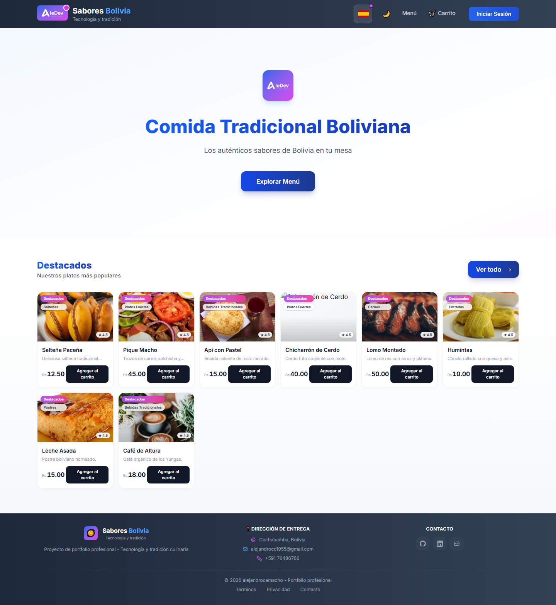

<p align="center">
  
</p>

<p align="center">
  <a href="https://food-app-by-ale.vercel.app">
    
  </a>
</p>

<p align="center">
  <a href="https://github.com/AlexandroCamacho1000/FoodAppByAle/actions">
    
  </a>
  
  
  
  
  
  
</p>

---

# FoodApp — Bolivian Market

<p align="center">
  
</p>

## 1. Overview
Aplicación web full-stack tipo SaaS para e-commerce de comida tradicional boliviana. Bilingüe (ES/EN), modo oscuro, panel administrador, pagos con Stripe y autenticación JWT. Incluye 49 tests automatizados (unitarios + E2E con Playwright) con CI/CD vía GitHub Actions, containerización con Docker, y deploy en producción en Vercel + Railway.

🔗 **Live Demo:** [food-app-by-ale.vercel.app](https://food-app-by-ale.vercel.app)  
⚙️ **Backend API:** [foodappbyale-production.up.railway.app/api](https://foodappbyale-production.up.railway.app/api/health)  
🤖 **CI/CD:** [github.com/AlexandroCamacho1000/FoodAppByAle/actions](https://github.com/AlexandroCamacho1000/FoodAppByAle/actions)

## 2. Technologies Used
**Frontend:** React 19, JavaScript (ES6+), Vite, Tailwind CSS 4, React Router 7, Axios  
**Backend:** Node.js, Express.js, PostgreSQL 16, Sequelize, JWT, bcryptjs, Stripe  
**Testing:** Vitest, Testing Library, Supertest, Playwright  
**DevOps:** Docker & docker-compose, GitHub Actions (CI/CD), Vercel, Railway  
**Tools:** Git & GitHub, Visual Studio Code, npm

## 3. Installation Guide (Run Locally)

**Docker (recomendado — un solo comando):**
```bash
git clone https://github.com/AlexandroCamacho1000/FoodAppByAle.git
cd FoodAppByAle
docker compose up -d
```
App en `http://localhost` · API en `http://localhost:5000/api`

**Backend Setup:**
```bash
cd backend
npm install
cp .env.example .env    # editar credenciales
npm run dev             # http://localhost:5000
```

**Frontend Setup:**
```bash
cd frontend
npm install
npm run dev             # http://localhost:5173
```

**Tests:**
```bash
# Frontend - unit tests (43 tests)
cd frontend && npm test

# Frontend - E2E tests (3 tests, Playwright)
cd frontend && npm run test:e2e

# Backend (3 tests, requiere PostgreSQL corriendo)
cd backend && npm test

# Todos los tests en CI (GitHub Actions)
# Se ejecutan automáticamente en cada push a main
```

---

<p align="center">
  <b>Desarrollado por</b><br />
  <a href="https://github.com/AlexandroCamacho1000">Alejandro Camacho</a>
</p>
